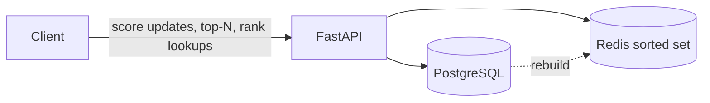

# Hi, I'm Pratik 👋

### Backend Software Engineer · C# / .NET Core / SQL Server

I build REST APIs and data-driven applications in C# and .NET, from loan-platform backends to real-time hardware monitoring clients.

---

### ⚡ What I'm Up To

- 🔭 **Currently building:** [Grounded QA](https://github.com/pratikgholam/groundedqa), a document Q&A API that answers from your documents (FastAPI, PostgreSQL/pgvector)
- 🌱 **Next:** LLD/HLD design-pattern projects in Python
- 💬 **Ask me about:** C#, .NET Core, REST API design, SQL Server / PostgreSQL optimization

---

### 📦 Projects

<table>
  <tr>
    <td width="50%" valign="top">
      <h4><a href="https://github.com/pratikgholam/loan-application-api">Loan Application API</a></h4>
      
ASP.NET Core REST API for submitting and reviewing loan applications, with JWT roles, EF Core + Dapper, and fake data

      
✅ Complete

    </td>
    <td width="50%" valign="top">
      <h4><a href="https://github.com/pratikgholam/groundedqa">Grounded QA</a></h4>
      
Document Q&A API (FastAPI, PostgreSQL/pgvector) that answers only from your documents

      
🚧 In progress

    </td>
  </tr>
  <tr>
    <td width="50%" valign="top">
      <h4><a href="https://github.com/pratikgholam/parking-lot-lld">Parking Lot (LLD)</a></h4>
      
Framework-free Python library modeling a parking lot, demonstrating Strategy, Factory, and State patterns in about 200 lines

      
✅ Complete

    </td>
    <td width="50%" valign="top">
      <h4><a href="https://github.com/pratikgholam/leaderboard-hld">Leaderboard (HLD)</a></h4>
      
Real-time leaderboard service in Python with FastAPI, Redis sorted sets, and PostgreSQL, supporting score updates, top-N queries, rank lookups, and rebuilds from the database

      
🚧 In progress

    </td>
  </tr>
  <tr>
    <td width="50%" valign="top">
      <h4><a href="https://github.com/pratikgholam/portfolio">Portfolio</a></h4>
      
Personal portfolio site built with React + Vite

      
✅ Complete

    </td>
    <td width="50%"></td>
  </tr>
</table>

---

### 🏗️ Leaderboard Architecture

---

<b>🛠️ Tech Stack & Tools</b>

 

